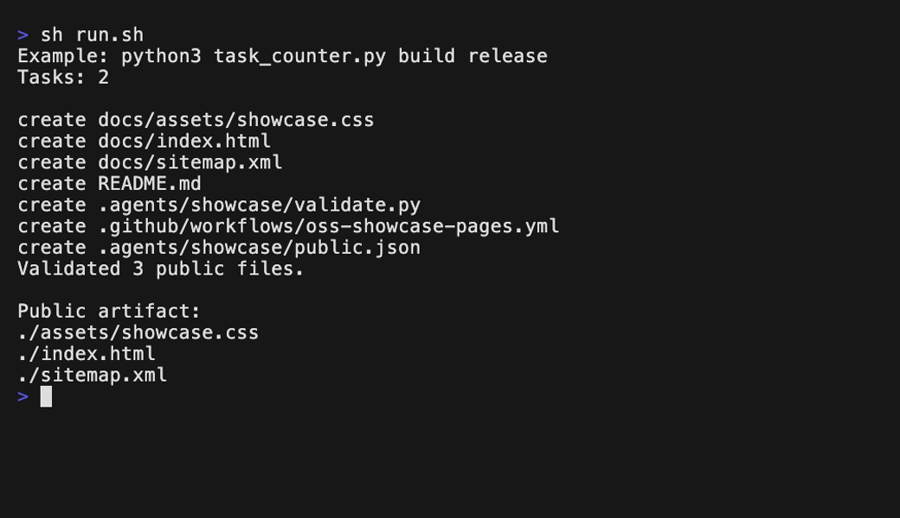

# OSS Showcase

**Your code runs. Give people a quickstart, a demo, and a project site they can trust.**

OSS Showcase is an Agent Skill for maintainers with a working GitHub project. It reads the repo, checks claims against code and tests, and proposes a plan you can review before it changes files.

[Quickstart](#quickstart) · [Watch the demo](#demo) · [Project site](https://ifthenelse.github.io/oss-showcase/) · [Latest release](https://github.com/ifthenelse/oss-showcase/releases/latest)

## Quickstart

From the project you want to showcase, with Node.js and npm available, run:

```sh
npx skills add ifthenelse/oss-showcase --skill oss-showcase
```

Choose your agent, then open a session in that project. In Codex, invoke `$oss-showcase`. In Claude Code, select `/oss-showcase`. In GitHub Copilot and other compatible hosts, ask the agent to use OSS Showcase on the current project. For a monorepo, specify the package. Include the public site URL if you know it.

**What you should see:** an ordered plan for your repository and a prompt to review the first pending step.

To install from a source archive, download and unpack the [latest release](https://github.com/ifthenelse/oss-showcase/releases/latest), then run this from the extracted directory:

```sh
sh scripts/install.sh
```

The installer copies the skill to `~/.agents/skills/oss-showcase/` and creates a Claude Code link.

## Demo

[](docs/assets/showcase-demo.mp4)

On a tiny synthetic Python CLI, Codex CLI and Claude Code CLI propose a showcase plan and pause at the first decision. The Claude desktop clip shows the plan and approval screen. [Reproduce the walkthrough](.agents/showcase/demo/README.md).

## Guided showcase workflow

1. **Find the angle.** Identify the audience, compare alternatives, and choose a message the code can support. [Market discovery](references/research.md)
2. **Make it tangible.** Set the visual direction, prepare the README, and record a real run on a safe fixture. [Branding](references/branding.md) · [Demo recording](references/demo.md)
3. **Stage the project site.** Generate HTML, CSS, and a sitemap with bundled Python tools. Verify copy, discovery metadata, and the files allowed into the Pages build. [Generation](references/state.md) · [SEO, GEO, and AEO](references/publishing.md#discovery)
4. **Plan the announcement.** Pick channels and dates, draft the posts, and verify the live site before sending traffic. [Launch distribution](references/distribution.md)

Use **Accept once** for one local step, **Always accept** for the remaining eligible local steps, or **Cancel** to skip the current step. Tasks appear in the client when supported. The handoff tracks unfinished work, and deploys and posts require separate confirmation. Existing project files stay read-only unless the skill can verify that it created them and they still match its last write. Existing project logic and workflows stay read-only. [Execution and approvals](references/execution.md)

## What you can do

| Goal | Mode |
| --- | --- |
| Review a README or site in read-only mode | `audit` |
| Verify audience, alternatives, and positioning | `research` |
| Review what changed and refresh stale showcase material | `refresh` |
| Verify a tagged release and review release-specific material | `prepare-release <ref>` |
| Draft a channel plan, calendar, and posts | `launch` |
| Publish to an approved destination | `publish` |

See [all operating modes](references/modes.md) and [optional integrations](references/integrations.md).

## Contribute

From a checkout of this repository, run the local checks:

```sh
scripts/verify
```

See [CONTRIBUTING.md](CONTRIBUTING.md) for development and PR guidance, [architecture](docs/architecture.md) for the package layout, and [SECURITY.md](SECURITY.md) for private vulnerability reporting.
